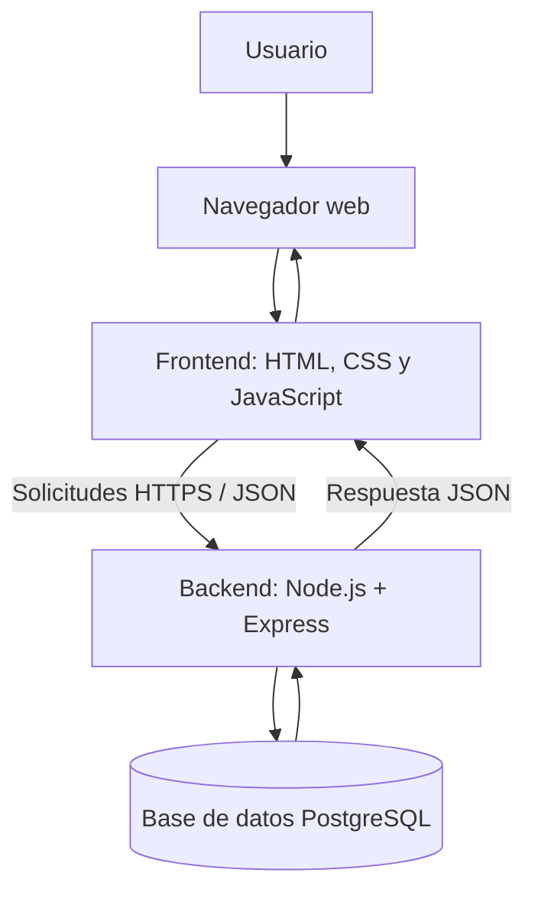

# Arquitectura del sitio EcoPuntos

**Tarea:** SCRUM-52 — Definir arquitectura del sitio, tecnologías, estructura de carpetas y estrategia de versiones.  
**Sprint:** 1 (26 de octubre al 9 de noviembre).  
**Estado del documento:** propuesta técnica inicial para revisión del equipo.

## 1. Objetivo

Definir una estructura sencilla, mantenible y escalable para EcoPuntos. La plataforma permitirá consultar centros de reciclaje, conocer los materiales que reciben y, conforme se desarrollen las funciones, administrar usuarios y registrar entregas y puntos.

## 2. Tipo de arquitectura

Se propone una **arquitectura web cliente-servidor por capas**, separando la interfaz, la lógica del servidor y el almacenamiento de información.

| Capa | Responsabilidad | Tecnología propuesta |
|---|---|---|
| Presentación (frontend) | Mostrar páginas, formularios, catálogo, perfil y resultados | HTML5, CSS3 y JavaScript |
| Aplicación (backend) | Validar solicitudes, aplicar reglas del sistema y ofrecer servicios | Node.js + Express |
| Datos | Guardar usuarios, centros, materiales y entregas | PostgreSQL |
| Comunicación | Intercambiar información entre frontend y backend | API REST con JSON sobre HTTPS |

### Diagrama general



El frontend no se conectará directamente a la base de datos. Todas las operaciones con información se realizarán mediante el backend para centralizar validaciones y proteger los datos.

## 3. Tecnologías

| Tecnología | Uso | Justificación |
|---|---|---|
| HTML5 | Estructura de las páginas | Estándar web y etiquetas semánticas |
| CSS3 | Diseño adaptable a celular y computadora | Permite mantener los estilos separados del contenido |
| JavaScript | Interacciones del sitio | Permite crear funciones dinámicas en el navegador |
| Node.js | Ejecutar JavaScript en el servidor | Usa el mismo lenguaje en frontend y backend |
| Express | Crear rutas y API REST | Es ligero y permite organizar los servicios |
| PostgreSQL | Base de datos relacional | Adecuada para relacionar usuarios, centros, materiales y entregas |
| Git y GitHub | Control de versiones y colaboración | Mantiene historial de cambios y facilita la revisión |
| Visual Studio Code | Editor de código | Permite trabajar con todos los archivos del proyecto |
| Navegador web | Ejecutar y probar la aplicación | Permite verificar la interfaz y su funcionamiento |

**Alcance actual:** el repositorio contiene páginas HTML, CSS y JavaScript de demostración. Node.js, Express y PostgreSQL son la propuesta para integrar el backend y la persistencia cuando el equipo lo acuerde; todavía no están configurados ni conectados.

## 4. Estructura de carpetas

### Estructura actual del repositorio

```text
ecopuntos/
├── index.html
├── perfil.html
├── css/
│   ├── styles.css
│   └── perfil.css
├── js/
│   ├── app.js
│   └── perfil.js
├── docs/
│   ├── CONVENCIONES.md
│   ├── PLAN_SPRINT1.md
│   ├── TABLERO_SPRINT1.csv
│   ├── modelo-datos.md
│   └── Diagrama-Modelo-de-Datos.png
├── .gitignore
├── README.md
└── CONTRIBUTING.md
```

### Organización propuesta al integrar el backend

```text
ecopuntos/
├── frontend/
│   ├── pages/
│   ├── css/
│   ├── js/
│   └── assets/
├── backend/
│   └── src/
│       ├── routes/
│       ├── controllers/
│       ├── services/
│       ├── models/
│       ├── middleware/
│       └── config/
├── database/
│   ├── migrations/
│   └── seeds/
├── docs/
├── .gitignore
├── README.md
└── CONTRIBUTING.md
```

La segunda estructura es una propuesta de organización futura, no representa carpetas que ya estén implementadas. La migración se hará cuando el equipo integre el servidor y la base de datos, evitando mover archivos innecesariamente durante este Sprint.

## 5. Flujo de funcionamiento

1. El usuario abre EcoPuntos desde su navegador.
2. El frontend muestra la página solicitada.
3. Cuando necesita consultar o guardar información, envía una solicitud a la API.
4. El backend valida los datos y ejecuta la operación correspondiente.
5. Si requiere información guardada, consulta PostgreSQL.
6. El backend responde en formato JSON y el frontend actualiza la pantalla.

## 6. Consideraciones de seguridad y calidad

- Validar los datos tanto en el navegador como en el servidor.
- No guardar contraseñas en texto plano; aplicar hash seguro cuando exista autenticación.
- No publicar contraseñas, tokens ni cadenas de conexión en GitHub.
- Usar variables de entorno para la configuración privada.
- Dar acceso a cada integrante según las necesidades del proyecto.
- Mantener el diseño adaptable y probar las páginas en distintos tamaños de pantalla.
- No utilizar información ficticia como si fueran centros reales.

## 7. Decisiones pendientes de confirmar

- Aprobación del equipo para usar Node.js, Express y PostgreSQL.
- Definición de alojamiento del backend y la base de datos.
- Definición de la estrategia de autenticación.
- Confirmación del formato final de la estructura de carpetas.

## 8. Resultado esperado de SCRUM-52

El equipo cuenta con una propuesta documentada de arquitectura, tecnologías, estructura actual y futura, flujo de funcionamiento y criterios básicos de seguridad. La propuesta puede revisarse con Product Owner y equipo de desarrollo antes de implementarla.
